# Claude + Blender 3D

> Concluído pelo Claude (Cowork) em 02/10/2026.

## O que é este estúdio

Este é o manual operacional de uma **produtora de motion 3D comercial operada por IA**. Ele junta duas coisas: o **cérebro de diretor** (o que fazer e por quê: ideia, narrativa, mundo visual, ritmo) e o **método técnico** (como uma IA opera o Blender 5.2 por script no nível de um estúdio: luz, material, câmera, render, pós e som, com números).

**Pra quem é:** pra IA (Claude Code no computador de quem usa, ou qualquer Claude com acesso a esta base) e pra quem aprende no módulo "Vídeos em motion 3D no Blender com Claude" do VKOSHUB. O teste da base é um só: uma IA lê estas páginas, recebe "vídeo de 20 s do meu app de delivery pro Reels" e entrega um filme que parece de produtora.

**O problema que ela resolve:** os filmes 3D feitos por IA saíam parecidos entre si e sem vida. Cor lavada (Standard em vez de AgX), luz chapada, enfeite flutuando sem motivo, fundo padrão, tela de app como placa plana, plástico de CG, curva de software, escuro sem intenção e a mesma linguagem em tudo. Cada página ataca essas causas com regra concreta e número.

## O fluxo de produção

```mermaid
flowchart LR
  A["0 Briefing<br>interrogatório"] --> B["1 Conceito<br>3 ideias, 1 escolhida"]
  B --> C["2 Tratamento<br>mundo, luz, lente, som"]
  C --> D["3 Shot list<br>quadros somam a duração"]
  D --> E["4 Animatic cinza<br>folha de contato"]
  E --> F["5 Câmera<br>lente, f-stop, curvas"]
  F --> G["6 Style frames<br>Cycles, 2 a 3 looks"]
  G --> H["7 Luz em todos os planos"]
  H --> I["8 Polimento da animação"]
  I --> J["9 Render<br>híbrido EEVEE + Cycles"]
  J --> K["10 Composição<br>texto e logo em 2D"]
  K --> L["11 Som<br>-14 LUFS"]
  L --> M["12 Entrega<br>bt709, laudo"]
```

Cada etapa gera um arquivo de prova que a IA olha antes de mostrar, e termina num portão de aprovação. Detalhes no cap 01 §6.

## Índice

| Página | Para que serve |
|---|---|
| **00 · Padrões da casa** | A fonte única dos números. Em conflito com qualquer capítulo, ela vence. |
| **01 · Cérebro de Diretor** | Como um diretor pensa: interrogatório, ideia, batidas por duração, tratamento, shot list, pipeline com portões, heurísticas, cura da mesmice e 5 exemplos completos. |
| **02 · Mundos Visuais** | 19 mundos visuais completos (banco) e a regra de rotação que impede dois filmes iguais. |
| **03 · Playbooks por Categoria** | 10 playbooks por categoria: planos clássicos, técnicas, armadilhas e estruturas de 15 s e 30 s. |
| **04 · Câmera e Movimento** | Lentes, profundidade de campo em escala real, movimentos, rigs, 12 princípios, curvas e timing. |
| **05 · Luz** | 9 rigs de luz com valores, cartões de reflexo, light linking, volumétrico, AgX e diagnóstico. |
| **06 · Materiais e Shaders** | Principled BSDF do 5.2 entrada por entrada, 26 receitas, imperfeição, chanfro e estilizados. |
| **07 · Render e Performance** | Cycles ou EEVEE, presets para a RTX 3050, passes, codecs e estimativa de tempo. |
| **08 · Pós, Cor e Som** | Compositor do 5.2, cor e look, design de som com licença comercial e tipografia sobre 3D. |
| **09 · Pipeline Claude ↔ Blender** | Como a IA opera o Blender: projeto, API 5.x confirmada por sonda, loop visual, MCP, assets e pegadinhas. |
| **10 · Controle de Qualidade** | Rubrica de 10 áreas, checklist de 55 itens "parece CG barato?" e o protocolo de revisão. |
| **11 · Biblioteca de Referências** | 83 referências (canais, estúdios, filmes, sites, assets) com licença (banco). |
| **12 · Modelos e Prompts** | Modelos de briefing, tratamento e shot list, o prompt-mestre, prompts por etapa e o prompt de revisão. |
| **Receitas (banco)** | 110 receitas técnicas com valores e status de teste. O Claude Code atualiza o status. |
| **🧪 Laboratório testado** | Do Claude Code: renders de prova, calibração e a verdade do Blender 5.2 medida na RTX 3050. |
| **🎥 Destilado do YouTube** | Do Claude Code: 129 vídeos do YouTube destilados em 9 temas. |

## Vou fazer meu primeiro vídeo: por onde começo

1. Leia **00 · Padrões da casa** (10 minutos). São os números que você vai usar.
2. Abra **12 · Modelos e Prompts** e copie o **prompt-mestre** (seção 6) para o Claude, junto com o seu briefing do jeito que estiver.
3. Responda as perguntas que ele fizer. O briefing confirmado é o portão 0.
4. Escolha 1 dos 3 conceitos. Aprove o tratamento. Aprove o shot list.
5. Olhe a **folha de contato do animatic cinza** antes de qualquer luz. É aqui que se acerta ritmo e enquadramento barato.
6. Escolha 1 dos 2 ou 3 style frames. Daqui pra frente a IA segue sozinha até a entrega, passando cada quadro pela rubrica do cap 10.
7. Quando o filme estiver pronto, ele entra no banco Briefings da página 12. O próximo filme vai sair diferente por regra.

## A régua de qualidade em 10 linhas

1. Uma ideia que só este produto justifica, lida em 1,5 s sem texto. Nada flutua sem função.
2. AgX sempre. Standard nunca em render fotorrealista. Cor de marca em 2D por cima.
3. Luz com direção: chave 3 a 4 vezes o preenchimento, contorno 1000 K mais frio e com light linking, fundo afastado e mais escuro.
4. Escala real em metros e chanfro em tudo (0,5 a 1 mm num celular).
5. Aspereza nunca é um número só: variação por ruído e imperfeição na escala certa.
6. Lente escolhida por plano; 50 mm nunca é a dominante; f-stop calculado em milímetros nítidos.
7. Curva assimétrica 10%/70%, overshoot medido, hold do herói de pelo menos 24 quadros.
8. Mundo, lente, acento e transição nunca repetem do filme anterior.
9. Texto com tempo de leitura calculado, dentro da máscara de zona segura, com altura mínima de 44 px.
10. Nenhum quadro é mostrado sem passar pela rubrica: média ≥ 4,0 e nenhuma área abaixo de 3.

## Plano de pesquisa (executado)

1. **01 · Cérebro de Diretor:** guias de tratamento e shot list, criativo para vídeo curto (Google ABCD, TikTok, Meta), School of Motion, Motionographer. 34 fontes.
2. **02 · Mundos Visuais:** filmes de produto por estética, estúdios (Buck, Tendril, ManvsMachine, Ordinary Folk, Six N. Five, Vucko), Behance, 80.lv. Cerca de 60 links.
3. **05 · Luz e 06 · Materiais:** manual do Blender 5.x (fonte RST), notas de versão 4.0 a 5.2, physicallybased.info, Poly Haven, ambientCG. 33 e 34 fontes, com provas renderizadas.
4. **03, 04, 07, 08:** breakdowns de estúdio, fotografia de produto, recomendações oficiais de YouTube e TikTok, ffmpeg, loudness, licenças de som. 54, 30+, 20+ e 40 fontes.
5. **09 · Pipeline:** cada item de API rodado no **bpy 5.2.2** instalado na nuvem do Cowork (sonda), com cena de exemplo em 4 voltas de loop visual.
6. **10, 11, 12:** rubrica e medidor `qa_extra.py` testado; 83 referências verificadas; modelos e prompts escritos a partir dos capítulos.
7. **Revisão cruzada:** um revisor leu os 11 capítulos inteiros, achou 25 contradições e 14 erros técnicos; as correções entraram nas páginas e os números finais foram para **00 · Padrões da casa**.
8. **ZIP** `claude-blender-3d-cowork.zip`: base em Markdown, 66 arquivos de código, provas, mundos.json, referencias.csv, pendências e fontes.

## Relatório final

### O que foi construído

- **13 páginas** (00 a 12), cerca de 140 mil palavras, todas em PT-BR, zero travessão, fonte citada em toda afirmação técnica relevante.
- **4 bancos de dados:** Mundos Visuais (19 fichas completas), Receitas (110 linhas com status de teste), Referências (83 itens com licença) e Briefings (5 exemplos completos, pronto pra registrar projetos).
- **Blender 5.2.2 rodando na nuvem do Cowork** (bpy como módulo, Cycles CPU e EEVEE). Toda a API citada foi conferida por sonda, e cerca de 40 renders de prova foram feitos e olhados (luz antes e depois, 9 rigs, grade de 12 materiais, imperfeição, estilizados, UI explodida, 3 mundos novos, curvas de velocidade, amostras e denoise, motion blur, pipeline em 4 voltas).
- **66 arquivos de código** organizados por tema, com status no cabeçalho, incluindo `base.py` (utilitários de pipeline), `materiais.py` (26 receitas), `rigs_luz.py` (9 rigs), `rigs_camera.py`, `curvas.py`, `presets.py`, `compositor_acabamento.py`, `qa_extra.py`, `animatic_blocking.py`, `rotacao_mundos.py` e os scripts de cada playbook.
- **Revisão cruzada** com 25 contradições resolvidas e a página **00 · Padrões da casa** como fonte única.

### O que ficou fraco ou não verificado

1. **Nada foi medido na RTX 3050 nesta rodada.** Fora os três tempos do Laboratório, todos os tempos de render, VRAM e farm são estimativa por regra de escala feita em CPU de 2 núcleos.
2. **O `qa.py` real nunca rodou nos testes da base.** Cada capítulo usou um medidor diferente (p95 menos p5, desvio padrão, `qa_extra`), então as faixas de contraste não são comparáveis entre capítulos.
3. **Nove dos 19 mundos são direção de arte no papel**, sem render; os três provados na nuvem usaram medidor caseiro.
4. **Zonas seguras sem fonte oficial** para TikTok e YouTube Shorts; os valores de pixel divergem até 250 px entre fontes secundárias.
5. **Fórmulas de leitura e tamanho de texto são derivadas** (Netflix, BBC, WCAG), não medidas em anúncio; duas fórmulas convivem.
6. **Splash por Mantaflow falhou** no bpy-módulo; o caminho de líquido "real" está sem prova.
7. **O Cowork não assistiu vídeo do YouTube.** O Claude Code destilou 129 (página Destilado do YouTube); sobraram 53 na lista de pendências, 28 de prioridade alta. As fichas de decomposição dos filmes de referência ainda têm luz, câmera e som em branco.
8. **Spec do Instagram Reels e loudness das redes** vêm de prática e fonte não oficial; o teste de loudness usou sinal sintético e dois medidores discordaram em 0,9 LU.
9. **EEVEE quase não foi provado em luz e material** (rigs, vidro, cartões, light path do HDRI, Thin Wall); a regra "filme híbrido" depende disso.
10. **MCP oficial do Blender Lab:** o Cowork só achou fonte de terceiros; o Destilado do YouTube do Claude Code confirma que ele existe a partir do 5.1. Ferramentas e limites ainda sem teste.
11. **Várias páginas do manual 5.2 e das notas de versão 5.x não abriram**; o que salva é a sonda, que confirma nome, não comportamento visual.
12. **Licenças pontuais sem conferência**: Kenney, BlendKit (lata), fontes Google família a família, DCTL do AgX no Resolve gratuito.
13. **Valores físicos de produto não medidos**: raio do canto do celular, lata de 350 ml, espessura de frasco e de papelão, pontuação OctaneBench.
14. **Regras de duração e ritmo** (hold do herói, número de planos, tempo de leitura) foram unificadas em 00 · Padrões da casa como **[provisório: decisão do dono]**; nenhuma foi validada assistindo o filme montado no celular.
15. **Imagens de prova não entraram no Notion:** o upload de arquivo pela nuvem do Cowork foi bloqueado pela rede. Todas as provas estão no ZIP, pasta `provas/`, com o nome citado em cada capítulo.
16. **Produto industrial** (categoria do briefing) não ganhou playbook próprio nem conceitos no banco do cap 01; estruturas de 6, 20 e 60 s e exemplo em 1:1 também faltam.

### Pendências para o Claude Code

Em resumo: rodar na RTX 3050 as receitas marcadas **[testar no Blender]** e atualizar o Status no banco Receitas; destilar os vídeos de prioridade alta abaixo (já cruzados com os 129 do Destilado do YouTube, sem repetição). A lista completa também está no ZIP, em `pendencias-claude-code.md`.

Ver `pendencias-claude-code.md`.

### As 10 descobertas que mais vão mudar os próximos filmes

1. **Light linking em toda luz de contorno** (e na chave quando o fundo está a menos de 50 cm). Na prova, o canto do fundo caiu de 0,785 para 0 e a média do quadro de 0,508 para 0,227. É a cura mais barata do "fundo mais claro que o herói".
2. **Profundidade de campo em escala real é de milímetros.** Celular a 60% do quadro 9:16: 8 mm nítidos a f/2,8 e 16 mm a f/5,6. No Blender fechar o diafragma não escurece nem difrata: f/8 a f/16 em ângulo é de graça.
3. **Curva assimétrica 10%/70% no lugar do padrão do Blender.** A câmera faz 47% do caminho em 27% do tempo e passa o resto assentando. Overshoot tem tabela medida: `back` 1,0 = 3,7%, 1,2 = 5,3%, 1,4 = 7,1%.
4. **Escurecer primeiro, depois acender só o herói.** O primeiro chute de energia estoura 20 a 28% do quadro. Use os watts absolutos da tabela do cap 05; produto opaco pede metade da energia do vidro.
5. **O AgX não devolve o hex da marca** (ΔE 7,2 contra 0,7 no Khronos PBR Neutral). Logo e cartela em 2D por cima; Khronos quando a embalagem é a estrela.
6. **Tela de app que não é placa:** emissão 1,0 e a mesma imagem na Base Color (pra receber sombra dos cartões), vidro de 0,7 mm, cartões a 8 a 15 mm e a chave fora do ângulo de reflexão. Sem isso a UI fica leitosa e o laranja vira rosa.
7. **Vidro e líquido:** bandeiras pretas a ±55°, cartões de reflexo invisíveis pra câmera, cartão de transluz atrás com degradê radial, cor por Volume Absorption (nunca pela Base Color) e transmissão de 12 a 24.
8. **Denoise vale mais que 4 vezes as amostras, e o filme é híbrido.** 64 amostras com OIDN batem 256 sem denoise em um quarto do tempo. 30 s todo em Cycles: cerca de 11 h; híbrido (EEVEE + Cycles só no vidro): cerca de 4 h 50 (estimado).
9. **Matriz BT.709 na entrega.** Sem `out_color_matrix=bt709` no ffmpeg, o laranja da marca volta R+9 G+7 B-7. Erro invisível no PC e visível no celular do cliente.
10. **Anti-mesmice medida, não opinada:** regra dos 4 eixos (mundo, lente dominante, família do acento, transição) com um script que recusa repetição, e animatic cinza que mede a altura do herói por plano (o teste pegou um plano com 14% quando a regra pede 20%).

